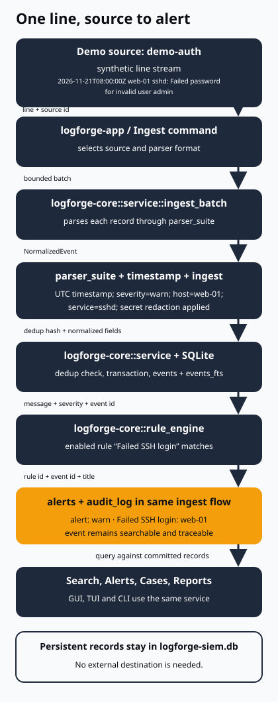
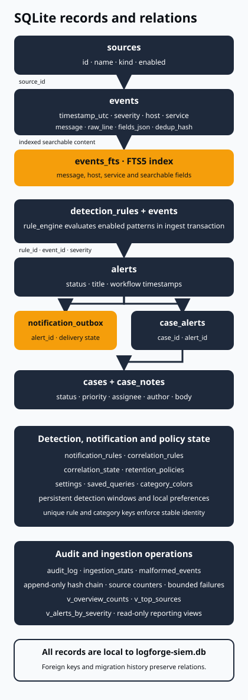

# LogForge-SIEM

Local-first SIEM-style log platform: ingests files and events, normalizes and deduplicates them, offers full-text search, correlation rules, alerts and investigation timelines. Desktop GUI, terminal UI and CLI. Data stays in one SQLite file.

## How it works






A demo line such as `2026-11-21T08:00:00Z web-01 sshd: Failed password for invalid user admin` enters through the `demo-auth` source. `logforge-app` passes it to `logforge-core::service`; `parser_suite` normalizes the record, timestamp handling converts its time to UTC, and `ingest` redacts credentials and computes a stable SHA-256 deduplication hash. The service stores accepted events in SQLite and its FTS5 index. `rule_engine` matches the `Failed SSH login` rule and stores the alert and audit record. The same service APIs power the desktop GUI, terminal UI and CLI. The data remains in `logforge-siem.db`.

## Install

Download the `0.1.0-dev` pre-release for your platform from GitHub Releases, or build from source with Rust `1.88.0`:

```bash
cargo build --release -p logforge-app
```

## Use

```bash
logforge-app demo load
logforge-app --ui tui
logforge-app search "Failed"
```

## Documentation

See [docs/README.md](docs/README.md).

## Security

See [SECURITY.md](SECURITY.md).

## Contributing

See [CONTRIBUTING.md](CONTRIBUTING.md).

## License

MIT. See [LICENSE](LICENSE). Copyright (c) 2026 Sonix Devs.
